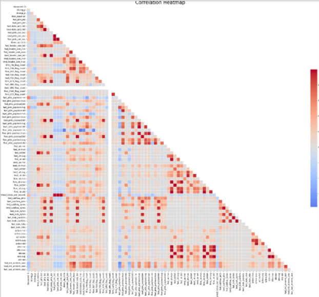
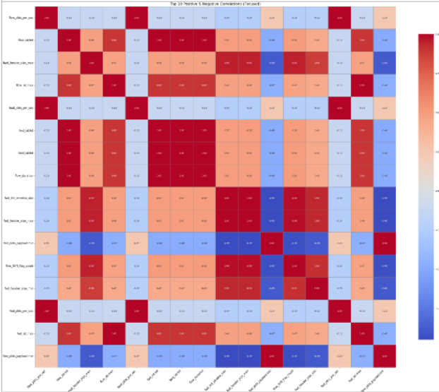
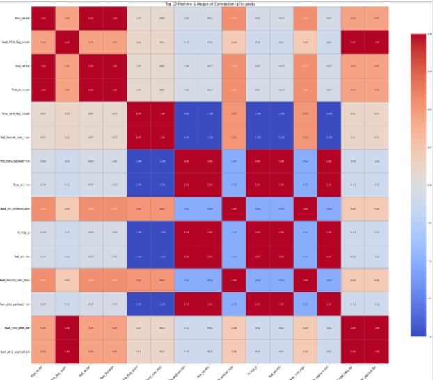
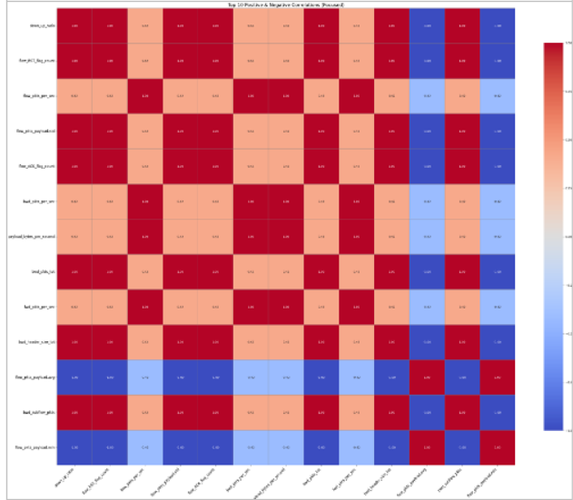
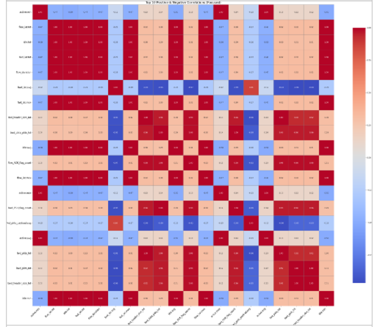
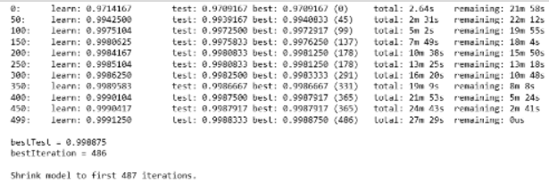
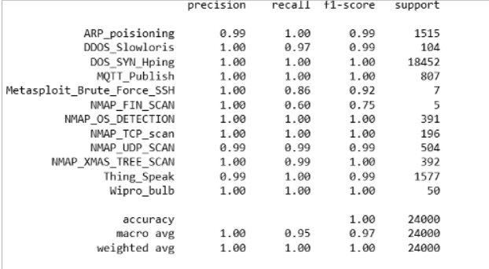
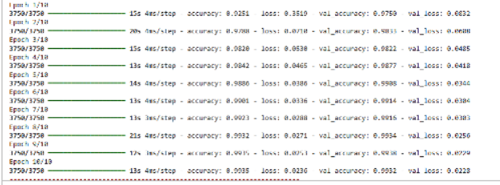
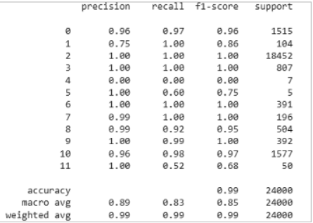
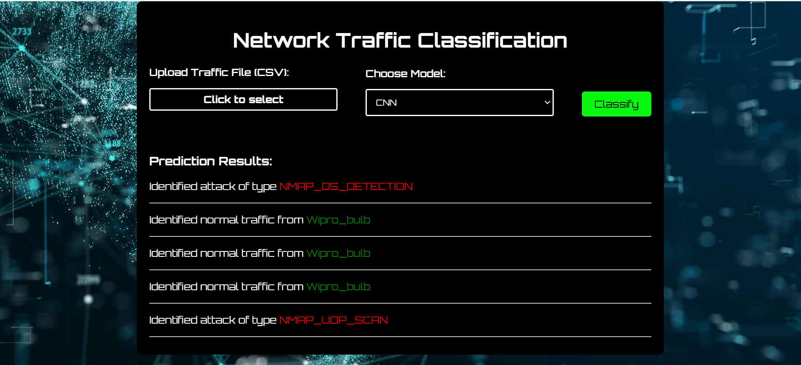

# Using ML for Intrusion Detection in IoT networks
## Problem Statement
With the increase in IoT solutions adoption among every household, cybersecurity experts face a challenge in securing networks by early identification of abnormal traffic. 
This is where ML can be a gamechanger, by early identifying threats in networks traffic. This paper presents training two models – a classifier and a CNN for this specific task. 

## Dataset Description
The dataset consists of 123.117 instances with 85 features, most of which are numerical. It contains both normal and abnormal traffic patterns, having substantial support for the latter category.  No missing or duplicate values were present in the dataset.

Attacks patterns Details: 
1.	DOS_SYN_Hping------------------------94659 – Attacks made with a tool used to generate custom TCP/IP packets to flood the network.
2.	ARP_poisioning--------------------------7750 - Attacks that send falsified ARP messages over a local area network.
3.	NMAP_UDP_SCAN--------------------2590 – Attacks that send empty UDP packets to target ports to determine their state (open, closed or filtered).
4.	NMAP_XMAS_TREE_SCAN--------2010 – Attacks that send TCP packets with the FIN, PSH, and URG flags set—resembling a "Christmas tree" due to the lit-up flags. It's used to identify listening ports based on RFC-compliant behavior (open or closed ports)
5.	NMAP_OS_DETECTION-------------2000 – Attacks that send various TCP and UDP probes to analyze responses and determine the target's operating system.
6.	NMAP_TCP_scan-----------------------1002 – Attacks that use TCP Connect Scan (-sT), where Nmap completes the full TCP three-way handshake.
7.	DDOS_Slowloris------------------------534 - Attacks that keep many connections to the target web server open and hold them open as long as possible.
8.	Metasploit_Brute_Force_SSH---------37 - Attempts to gain unauthorized access via SSH by systematically trying passwords.
9.	NMAP_FIN_SCAN---------------------28 –Attacks that send TCP packets with only the FIN flag set to detect open ports.

Normal Patterns Details: 
1.	MQTT -----------------------------------8108 - Standard communication using the MQTT protocol.
2.	Thing_speak-----------------------------4146 - Data transmission to the ThingSpeak cloud platform.
3.	Wipro_bulb_Dataset-------------------253 - Normal operation of a Wipro smart bulb.

The correlation matrix shows highly correlated values along the instances:

For the purpose of real-life testing, I decided to split the dataset into 120.000 instances used for training the two models and use the remaining 3.117 instances for testing their performance with unseen data. I also split the dataset into seaparate files for each category.
In order to further examine the dataset, I created a separate file for each of the trafiic patterns, and printed the highest top 10 correlations for each type of attack. We will analyze them separately:

Here, we should focus on the strong negative correlations in the matrix. The first one that draws our attention is fwd_pkts_payload_min and fwd_header_size_max (-0.95). In regular communication, most of the data is in the payload, but in ARP poisoning, many packets don’t carry useful content — they’re just there to manipulate or control the network.

The next one is between fwd_pkts_per_sec and flow_iat_tot (-0.89), which shows us that inter-arrival times drop while the number of packets increases, which is consistent behavior for such an attack.

Like in the case of ARP poisoning, we have a strong negative correlation between the forward payload and the header size. Here we can also notice that time related features (flow_iat_tot, bwd_iat_tot, flow_duration) are highly correlated, suggestive of the type of the attack: sending partial HTTP requests slowly in order to consume server resources.

In here we notice strong positive corelations between flow_pkts_per_sec and payload_bytes_per_sec, and also bwd and fwd_pkts_per_sec, which may be suggestive of a SYN attack. 
The header size is once again negatively correlated to the flow, suggesting empty payloads are being sent. 
The strong negative correlation between flow packet payload features and the down/up ratio shows that the attack focuses on sending packets upstream, without completing the TCP handshakes. The victim responds with SYN-ACK packets but does not receive the ACK response.

This is a normal traffic pattern correlation matrix, from which we can draw the following conclusions:
1. strong correlations between forward and backward flow metrics suggest legitimate operations, bi-directional communication,
2. the negative correlation between bwd_iat_avg and bwd_data_pkts_tot shows that as the total number of data packets increases, the average time between those packets decreases, indicating legitimate, responsive communication rather than the pattern we see in automated attacks.

## CatBoost Classifier
CatBoost Classifier is a new classification model, that uses both numerical and categorical features, without the need for encoding. It is widely used in intrusion detection systems at the moment. 
The model passes through the data multiple times (similar to the epochs in a neural network) and for each pass, it looks at the mislabeled data in order to improve it’s results. It automatically saves the best iteration through the data.

The classification report shows that classes are unbalanced, however the model can successfully classify the data, having a 0.9988 accuracy in it’s predictions:

The confusion matrix shows the model identifies data in all of the columns:

The Mathews Correlation Coefficient for this model is almost perfect, at 0.9971, showing the model is not biased towards the majority class.

## CNN - Conv1D
For this part I used a feed-forward neural network – an approach often used in the field. Facing overfitting initially, with validation values remaining static across the ten epochs, I reduced the filters and the dense layer, in order to obtain better results. Next, I encoded all of the categorical values, and shuffled the entities, and the result was a validation accuracy of 0.9932 in the tenth epoch, a value slightly lower than that in the nineth:

The classification report shows that the classes are unbalanced:

Yet the confusion matrix shows the model performing well even in this case:

The model has, however, failed to identify data in the fourth column.
The Matthew’s Correlation Coefficient was: 0.9829, showing that the model performs well for this dataset.

## GUI
In order to demonstrate interraction with the two models, I created a simple graphical interface using Flask:

Here, the users can upload a log file and select the desired model, and receive information about the logged data in the form of normal traffic or identified attack. The difference in accuracy between the models shows when providing a normal Wipro Bulb file – that is correctly classified by CatBoost, but misclassified in two instances with the CNN.

## Bibliography
1. https://archive.ics.uci.edu/dataset/942/rt-iot2022
2. https://catboost.ai/docs/en/concepts/python-reference_catboostclassifier
3. https://scikit-learn.org/stable/modules/generated/sklearn.metrics.matthews_corrcoef.html
4. https://www.ibm.com/think/topics/convolutional-neural-networks